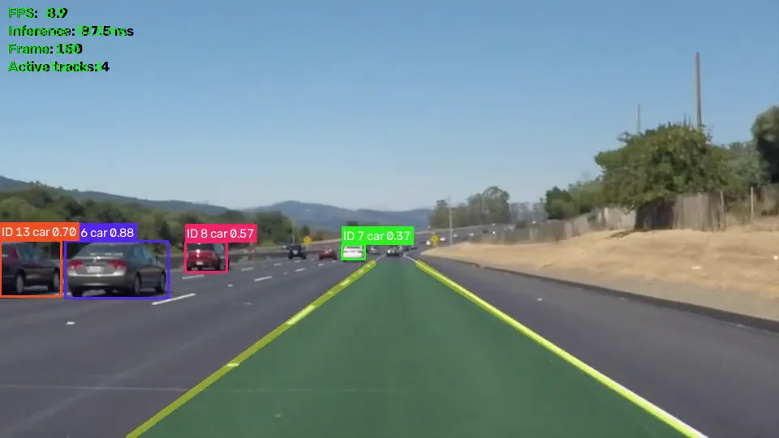
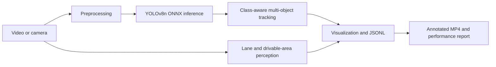

# Edge Road Perception

[](https://github.com/BoltTaha/edge-road-perception/actions/workflows/ci.yml)
[](https://www.python.org/)
[](https://onnxruntime.ai/)
[](LICENSE)

**Edge Road Perception is a modular Python computer-vision system for road video.** It detects vehicles and pedestrians with YOLOv8n through ONNX Runtime, maintains track IDs with a ByteTrack-style tracker, estimates lane boundaries with OpenCV, and exports annotated video, structured JSONL detections, and reproducible performance reports.

This is an independent open-source reference implementation built with public footage and reusable components. It contains no client data, credentials, private datasets, or private project assets.

[](outputs/solidWhiteRight_annotated.mp4)

**[Watch the annotated output](outputs/solidWhiteRight_annotated.mp4)** · **[Read the technical case study](https://muhammadtaha.app/projects/autonomous-driving-edge-perception)**

## What it does

- Detects cars, people, bicycles, motorcycles, buses, and trucks.
- Maintains visible object identities with a Kalman filter and class-aware Hungarian IoU matching.
- Estimates lane boundaries and shades the inferred drivable region.
- Displays processing FPS, inference time, frame number, and active-track count.
- Writes JSONL with frame timestamps, classes, scores, boxes, and track IDs.
- Reports mean, p50, p95, and maximum timing for detection, tracking, lane processing, and the measured compute path.
- Centralizes model paths, thresholds, providers, lane ROI, and output behavior in `config.py`.

## Architecture



Each stage is replaceable. ONNX Runtime keeps PyTorch out of the runtime dependency set and provides a practical path to TensorRT, HailoRT, OpenVINO, or another hardware-specific runtime.

## Repository layout

```text
.
├── main.py                         # CLI entry point
├── config.py                       # paths, thresholds, providers, and I/O
├── models/yolov8n.onnx             # public pretrained detector
├── src/
│   ├── detector.py                 # ONNX inference, preprocessing, NMS
│   ├── tracker.py                  # Kalman filter and Hungarian matching
│   ├── lane_detection.py           # Canny, ROI, Hough, smoothing
│   ├── visualizer.py               # boxes, IDs, lane overlay, HUD
│   ├── output_writer.py            # frame-level JSONL
│   ├── performance.py              # latency distributions and memory
│   └── pipeline.py                 # pipeline orchestration
├── test_videos/                    # three public Udacity road clips
├── outputs/                        # annotated videos, JSONL, reports
├── tests/                          # focused behavior tests
└── docs/                           # architecture, benchmarking, edge guide
```

## Install

```bash
git clone https://github.com/BoltTaha/edge-road-perception.git
cd edge-road-perception
python -m venv .venv
source .venv/bin/activate          # Windows: .venv\Scripts\activate
python -m pip install --upgrade pip
pip install -r requirements.txt
```

PyTorch is not required to run the included model.

## Run

```bash
python main.py
python main.py --source test_videos/challenge.mp4
python main.py --source test_videos/solidYellowLeft.mp4 --max-frames 100
python main.py --source /path/to/road-video.mp4
python main.py --source 0 --display
```

Each run writes an annotated MP4, a JSONL detection stream, and a JSON performance report into `outputs/`.

## Structured output

```json
{"frame": 42, "timestamp_ms": 1680.0, "tracks": [
  {"track_id": 3, "class_id": 2, "bbox": [412.1, 288.4, 501.7, 350.2], "score": 0.87}
]}
```

## Measured results

The checked-in reports come from full runs on the three public clips using one logical CPU and ONNX Runtime's CPU execution provider.

| Clip | Frames | Processing FPS | Mean inference | Mean tracking | Mean lane time |
|---|---:|---:|---:|---:|---:|
| `solidWhiteRight` | 221 | 9.58 | 91.96 ms | 0.45 ms | 3.61 ms |
| `solidYellowLeft` | 681 | 9.54 | 92.30 ms | 0.32 ms | 3.58 ms |
| `challenge` | 251 | 9.42 | 91.63 ms | 0.34 ms | 7.54 ms |

These are development-machine measurements, not Jetson, Hailo, Raspberry Pi, GPU, or production claims. The processing FPS is derived from the measured detector, tracking, and lane compute path; capture, rendering, video encoding, and output writes are outside that total. Run the pipeline on the target hardware before quoting deployment performance. See [Benchmarking](docs/benchmarking.md).

## Edge deployment direction

- **Jetson Orin:** convert ONNX to TensorRT, establish FP16 first, then evaluate calibrated INT8.
- **Raspberry Pi 5 plus Hailo:** compile the detector to HEF and keep tracking and lane processing on the host CPU.
- **Intel edge hardware:** evaluate OpenVINO behind the same detector interface.
- **CPU-only:** reduce the detector input size and measure the accuracy-latency tradeoff.

Detector inference dominates the measured compute time, so runtime, precision, and input resolution should be optimized before the smaller tracking and lane stages. See the [edge deployment guide](docs/edge_deployment_recommendation.md).

## Limitations

- Perception only: no planning, control, localization, SLAM, sensor fusion, or vehicle integration.
- Not safety certified and not suitable for controlling a vehicle.
- The included model is pretrained on COCO rather than a road-specific labeled dataset.
- Public clips demonstrate integration; they do not constitute an accuracy benchmark.
- Tracking has not yet been reported with HOTA, MOTA, or IDF1.
- Classical lane detection can degrade on unmarked roads, sharp curves, glare, shadows, construction, and heavy occlusion.

## Tests

```bash
python -m unittest discover -s tests -v
python -m compileall -q main.py config.py src tests
```

GitHub Actions runs these checks on Python 3.10 and 3.12.

## License and public data

This repository is distributed under GNU AGPL-3.0 because it includes a public Ultralytics YOLOv8 model artifact. Review [LICENSE](LICENSE) and [THIRD_PARTY_NOTICES.md](THIRD_PARTY_NOTICES.md).

The bundled videos come from Udacity's MIT-licensed `CarND-LaneLines-P1` repository and contain no client footage.

## Author

Built and maintained by **Muhammad Taha (BoltTaha)**, an AI engineer working on computer vision, Edge AI inference, video analytics, and production AI systems.

- [Portfolio](https://muhammadtaha.app)
- [GitHub](https://github.com/BoltTaha)
- [LinkedIn](https://www.linkedin.com/in/bolttaha/)
- [Upwork](https://www.upwork.com/freelancers/~01841c07c5ecaeebaf)
- [Contact](https://muhammadtaha.app/contact)

